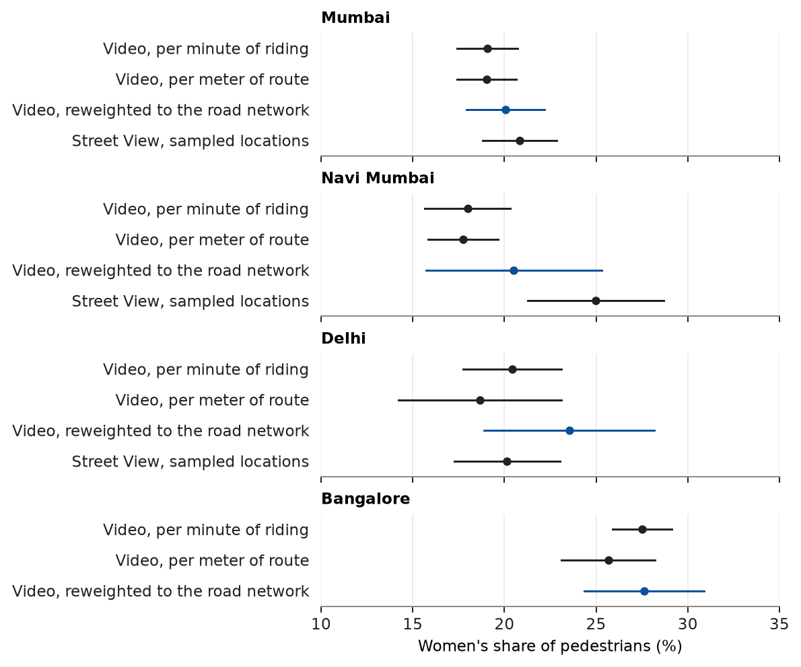

# Sampling Streets: Design-Based Inference for Street-Level Field Measurement

Varun K.R. and Gaurav Sood

[Paper](ms/main.pdf) · [Data](data/README.md)

## Question and motivation

Researchers measure streets with cameras and sensors: who is visible in public, how loud a road is, how dirty the air is. Most such data come from wherever access was easy, such as platform imagery or routes a team could reach. Numbers from such data describe the places measured, not the city. This paper asks what it takes to make a street-level measurement a statement about a city: a list of streets to sample from, a random draw from that list, and standard errors that follow from the draw.

## Data and research design

The frame is the road network from OpenStreetMap, cut into 500-meter segments. [geo-sampling](https://github.com/geosensing/geo-sampling) draws the sample, [allocator](https://github.com/geosensing/allocator) groups sampled points into field routes, and [geoestimate](https://github.com/geosensing/geoestimate) produces estimates and standard errors.

The applications fall into two designs.

- **Point samples.** The unit observed is the unit drawn: Street View images at sampled segments. Road condition in Bangkok, Jakarta, Lagos and Wayne County, Michigan ([streetsense](https://github.com/geosensing/streetsense)); women's share of pedestrians in Mumbai, Navi Mumbai and Delhi ([streetsight](https://github.com/geosensing/streetsight)).
- **Route samples.** A rider travels between sampled points and the instrument observes the route: video frames cut at fixed time intervals in Mumbai, Navi Mumbai, Delhi and Bangalore ([streetscope](https://github.com/geosensing/streetscope)), and sound-meter and air-monitor readings in Delhi ([soundscape](https://github.com/geosensing/soundscape), [streetaqi](https://github.com/geosensing/streetaqi)).

Route samples are reported three ways: as collected, weighted by the rider's speed (which turns a per-minute sample into a per-meter one), and also reweighted so road classes have their share in the drawn sample. A simulation with a known truth checks the estimators.

## Key findings

Drawing points at random is not enough when the instrument rides between them. In Delhi, 85% of sampled points are on residential roads but 27% of video frames are. Reweighting road classes to the drawn sample moves women's share of pedestrians in Delhi from 20.4% to 23.5%, a shift of 3.1 points (95% interval 0.5 to 6.8), and the share of noise readings peaking at or above 100 dB from 14.4% to 8.1%. In a simulation where road class is the only way routes differ from the city, intervals from the unadjusted route sample cover the truth 32% of the time and the reweighted ones 95%. Speed weighting alone makes the estimate worse.



Across cities and weightings, women are 18% to 28% of pedestrians.

A route sample is still a probability sample. A stretch of road is photographed at a rate proportional to how often the routing rule sends the rider along it, divided by the rider's speed there; weighting by the inverse of that rate is unbiased, and reweighting by road class approximates it. Within road classes, frames beside sampled points and frames on the way between them show similar shares of women.

## Reproduce

```
make restore
make check
```

The manuscript needs pdfLaTeX and latexmk. Every result in the text comes from `tabs/macros.tex`, which `scripts/06_tables.py` writes from the analysis output.

## Files and pipeline

| Path | Contents |
|---|---|
| `ms/` | Manuscript and bibliography |
| `src/streetscan/` | Functions the stages share |
| `scripts/` | Numbered pipeline stages; `99_run_all.py` runs them in order |
| `scripts/extract/` | One-off importers from the application repositories; not part of the pipeline |
| `data/raw/` | Per-unit tables the analysis starts from |
| `tabs/`, `figs/` | Generated tables, macros and figures |
| `tests/` | Tests |

### Execution stages

| Script | Purpose |
|---|---|
| `01_prepare_data.py` | Check raw tables against their hashes |
| `02_estimate.py` | Estimate every reported quantity under each design |
| `03_simulate.py` | Check the estimators in a simulated city with a known truth |
| `04_simulate_routes.py` | Check, on a street grid, that a route sample is a probability sample with a computable rate of inclusion |
| `05_figures.py` | Draw the figures |
| `06_tables.py` | Write the tables and the macros the manuscript cites |
